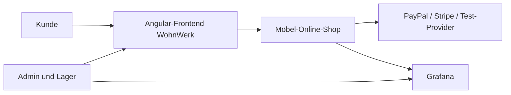
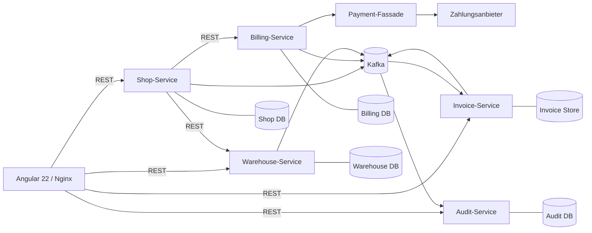
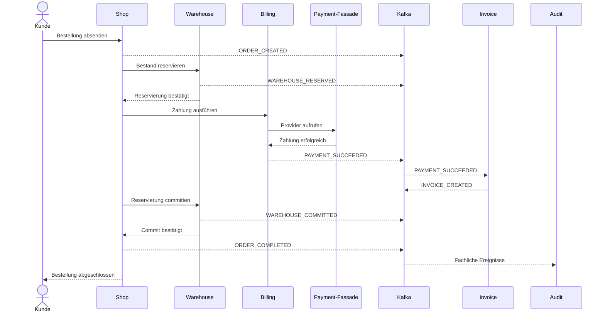
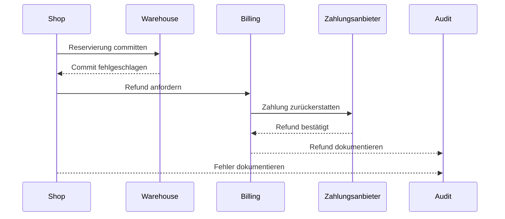

# Architektur des Möbel-Online-Shops

## 1. Ziel und Umfang

Der Online-Shop bildet einen vollständigen Bestellprozess ab. Ein Kunde wählt
Möbel aus, bestellt und bezahlt. Mehrere Services reservieren den Bestand,
verarbeiten die Zahlung, erstellen die Rechnung und dokumentieren den Ablauf.

Dieses Dokument beschreibt nur die Architektur: Systemgrenzen, Komponenten,
Kommunikation, Ereignisse, Datenhoheit und wichtige Entscheidungen. Die
konkrete Umsetzung, Tests und Ergebnisse werden im
[Abschlussbericht](report/abschlussbericht.pdf) beschrieben.

Die Architektur folgt drei Regeln:

- REST liefert eine direkte Antwort, wenn der nächste Schritt davon abhängt.
- Kafka verteilt fachliche Ereignisse an unabhängige Empfänger.
- Jeder Service verwaltet nur seine eigenen Daten.

## 2. Systemkontext

Kunden und interne Benutzer arbeiten über das Angular-22-Frontend mit dem
System. Externe Zahlungsanbieter verarbeiten Zahlungen und Refunds. Grafana
unterstützt das Team bei der technischen Kontrolle.

Das Frontend besitzt keine fachlichen Daten. Produkte, Bestellungen,
Reservierungen, Zahlungen, Rechnungen und Audit-Einträge bleiben in den
zuständigen Backend-Services.

## 3. Komponenten und Verantwortlichkeiten

| Komponente | Verantwortung |
|---|---|
| Shop-Service | Produkte, Bestellungen und Ablaufsteuerung |
| Warehouse-Service | Bestand und Reservierungen |
| Billing-Service | Zahlungen und Refunds |
| Payment-Fassade | PayPal, Stripe und Test-Provider kapseln |
| Invoice-Service | Rechnungen erstellen |
| Audit-Service | Fachliche Historie speichern |

Die Payment-Fassade hält den konkreten Zahlungsanbieter vom Shop fern. Ein
neuer Provider verändert weder den Shop-Service noch dessen Bestell-API.

## 4. Kommunikationsmodell

### REST

REST steuert Entscheidungen, die sofort bestätigt werden müssen:

- Reservierung des Bestands
- Zahlung über Billing
- Commit oder Cancel einer Reservierung
- Refund-Anforderung nach einem Commit-Fehler
- Abfragen des Frontends

Der Aufrufer kennt nach der Antwort den nächsten möglichen Schritt.

### Kafka

Kafka verteilt fachliche Ereignisse. Invoice kann auf eine erfolgreiche
Zahlung reagieren, während Audit dasselbe Ereignis unabhängig speichert. Ein
Publisher muss diese Consumer nicht direkt aufrufen.

Die Topics folgen den fachlichen Besitzern:

| Topic | Ereignisse |
|---|---|
| `shop` | `ORDER_CREATED`, `ORDER_COMPLETED`, `ORDER_CANCELLED` |
| `billing` | `PAYMENT_SUCCEEDED`, `PAYMENT_FAILED` |
| `warehouse` | `WAREHOUSE_RESERVED`, `WAREHOUSE_COMMITTED`, `WAREHOUSE_CANCELLED` |
| `invoice` | `INVOICE_CREATED`, `INVOICE_CREATION_FAILED` |

REST und Kafka ergänzen sich. REST steuert den unmittelbaren Ablauf. Kafka
entkoppelt die spätere Verarbeitung.

## 5. Bestellprozess

Der Shop erstellt die Bestellung und vergibt eine Correlation-ID. Warehouse
reserviert die gewünschten Artikel. Nur bei ausreichendem Bestand startet
Billing die Zahlung.

Nach einer erfolgreichen Zahlung veröffentlicht Billing
`PAYMENT_SUCCEEDED`. Invoice darf daraufhin die Rechnung erstellen. Der Shop
fordert gleichzeitig den Warehouse-Commit an. Erst nach
`WAREHOUSE_COMMITTED` veröffentlicht der Shop `ORDER_COMPLETED`.

Der Happy Path besitzt eine feste Reihenfolge:

1. `ORDER_CREATED`
2. `WAREHOUSE_RESERVED`
3. `PAYMENT_SUCCEEDED`
4. `WAREHOUSE_COMMITTED`
5. `ORDER_COMPLETED`

## 6. Fehler- und Kompensationsabläufe

### Kein Bestand

Warehouse lehnt die Reservierung ab. Der Shop beendet den Vorgang, bevor
Billing eine Zahlung startet.

### Zahlung fehlgeschlagen

Billing veröffentlicht `PAYMENT_FAILED`. Der Shop storniert die Reservierung.
Warehouse gibt den Bestand frei und veröffentlicht `WAREHOUSE_CANCELLED`. Der
Shop meldet anschließend `ORDER_CANCELLED`.

### Commit fehlgeschlagen

Die Zahlung war erfolgreich, aber Warehouse konnte den Bestand nicht endgültig
buchen. Der Shop fordert über Billing einen Refund an und veröffentlicht kein
`ORDER_COMPLETED`.

### Rechnung fehlgeschlagen

Invoice versucht die Erstellung erneut und meldet bei anhaltendem Fehler
`INVOICE_CREATION_FAILED`. Ein Rechnungsfehler löst keinen Refund aus.

## 7. Event-Verträge

Alle Ereignisse verwenden einen gemeinsamen Envelope:

| Feld | Bedeutung |
|---|---|
| `eventId` | eindeutige Event-ID |
| `eventType` | fachlicher Ereignisname |
| `correlationId` | Verbindung zu einer Bestellung |
| `source` | veröffentlichender Service |
| `occurredAt` | Zeitpunkt |
| `payload` | fachlicher Inhalt |

Der Envelope bleibt stabil. Jeder Consumer wertet nur die Payload aus, die er
benötigt. Die Eventnamen werden ausschließlich in Großbuchstaben mit
Unterstrichen geschrieben.

Der Audit-Service verknüpft die Timeline zusätzlich über `previousEventId`.
Fehlt dieser Wert, verwendet er den letzten Eintrag derselben Correlation-ID.

## 8. Datenhoheit

Shop, Billing, Warehouse und Audit besitzen getrennte PostgreSQL-Datenbanken.
Invoice besitzt einen eigenen Speicher für PDF-Dateien und Metadaten. Kein
Service greift direkt auf den Speicher eines anderen Service zu.

Diese Trennung erlaubt Änderungen am internen Datenmodell, solange REST- und
Event-Verträge stabil bleiben. Eine globale Datenbanktransaktion gibt es nicht.
Reservierung, Cancel, Refund und Idempotenz gleichen fehlgeschlagene Schritte
aus.

## 9. Idempotenz

REST-Aufrufe können nach einem Timeout wiederholt werden. Kafka kann ein Event
mehrfach zustellen. Deshalb müssen Wiederholungen ohne zusätzliche fachliche
Wirkung bleiben.

- Dieselbe `orderId` liefert dieselbe Reservierung zurück.
- Ein doppelter Commit oder Cancel ändert den Bestand nicht erneut.
- Dieselbe `transactionId` erzeugt keine zweite Rechnung.
- Dieselbe `eventId` erzeugt keinen zweiten Audit-Eintrag.

Warehouse schützt parallele Zugriffe zusätzlich durch Datenbanksperren.

## 10. Observability

OpenTelemetry sammelt technische Telemetrie der .NET-Services. Loki speichert
strukturierte Logs. Grafana macht sie durchsuchbar. Health-Endpunkte zeigen die
Erreichbarkeit der Services.

Observability und Audit haben verschiedene Aufgaben. Grafana und Loki erklären
den technischen Zustand. Audit erklärt den fachlichen Ablauf. Die
Correlation-ID verbindet beide Sichten.

## 11. Deployment

Docker Compose startet Frontend, Services, PostgreSQL-Datenbanken, Kafka und
Observability als gemeinsamen lokalen Stack. Nginx liefert das Angular-Frontend
aus und leitet relative API-Pfade an die zuständigen Services weiter.

Das Frontend kennt dadurch keine internen Container-Adressen. Konfiguration und
persistente Daten liegen in Umgebungsvariablen und Docker Volumes.

## 12. Architekturentscheidungen

### ADR 1: Fachliche Microservices

Shop, Lager, Zahlung, Rechnung und Audit erhalten eigene Verantwortlichkeiten.
Das macht ihre Grenzen sichtbar und erlaubt unabhängige Änderungen.

### ADR 2: REST und Kafka gemeinsam

Direkte Entscheidungen laufen über REST. Fachliche Ereignisse laufen über
Kafka. Diese Aufteilung verbindet eine klare Antwort an den Kunden mit
entkoppelter Verarbeitung.

### ADR 3: Database per Service

Jeder Service kontrolliert seine Daten. Andere Services verwenden nur
definierte APIs und Ereignisse.

### ADR 4: Append-only Audit

Audit-Einträge werden ergänzt, aber nicht fachlich überschrieben. Die Event-ID
verhindert doppelte Einträge.

### ADR 5: Payment-Fassade

Billing kapselt Zahlungsanbieter hinter einer stabilen Schnittstelle. Zahlung
und Refund verwenden denselben Zugang.

### ADR 6: Sichere Wiederholungen

Fachliche Schlüssel schützen Reservierung, Zustandswechsel, Rechnung und Audit.
Dadurch bleiben Retries und doppelte Nachrichten beherrschbar.

## Fazit

Die Architektur trennt fachliche Verantwortlichkeiten klar voneinander und verbindet synchrone Entscheidungen mit ereignisbasierter Kommunikation. Durch Database per Service, stabile Event-Verträge und idempotente Verarbeitung bleibt das System nachvollziehbar und erweiterbar. Die praktische Umsetzung sowie die Testergebnisse werden im Abschlussbericht beschrieben.