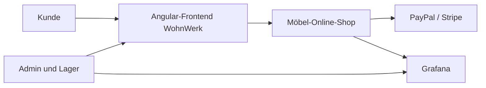
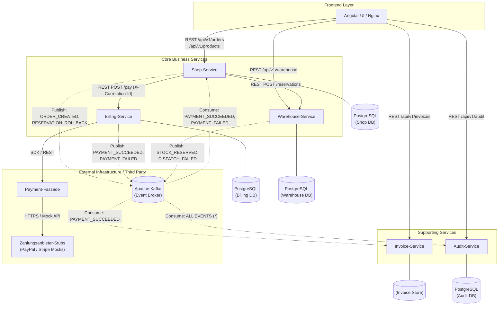
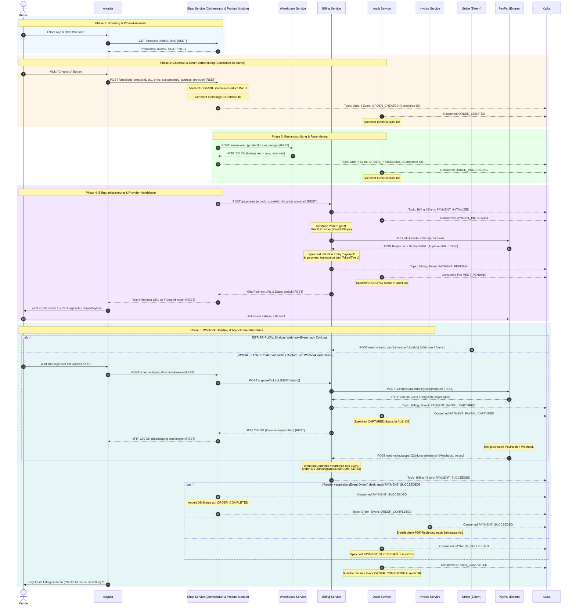
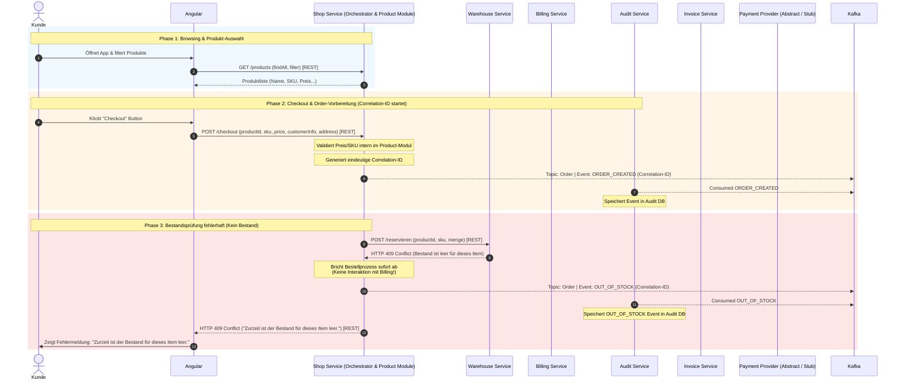
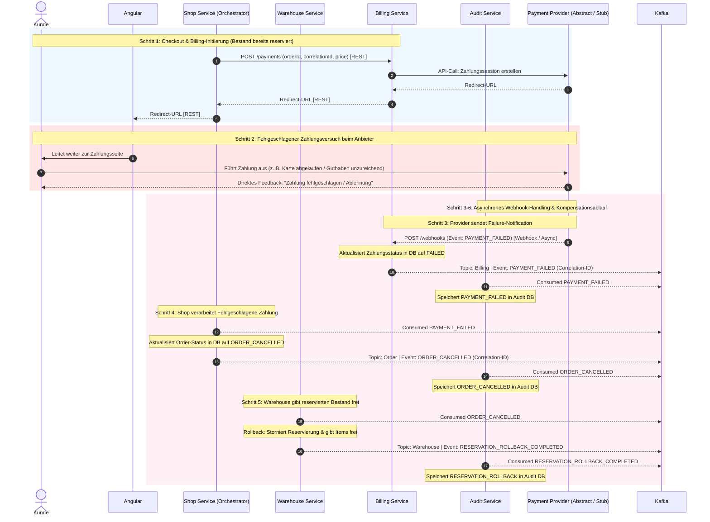
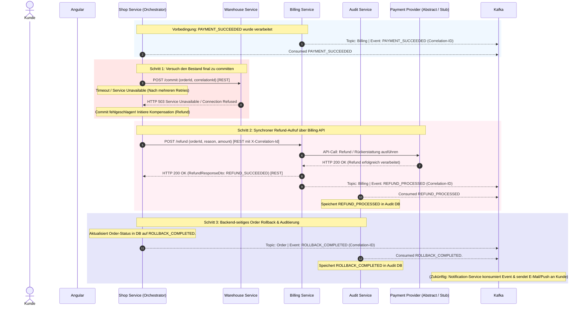

# Architektur des Möbel-Online-Shops

## 1. Ziel und Umfang

Der Online-Shop bildet einen vollständigen Bestellprozess ab. Ein Kunde wählt
Möbel aus, bestellt und bezahlt. Mehrere Services reservieren den Bestand,
verarbeiten die Zahlung, erstellen die Rechnung und dokumentieren den Ablauf.

Dieses Dokument beschreibt nur die Architektur: Systemgrenzen, Komponenten,
Kommunikation, Ereignisse, Datenhoheit und wichtige Entscheidungen. Die
konkrete Umsetzung, Tests und Ergebnisse werden im
[Abschlussbericht](report/abschlussbericht.pdf) beschrieben.

Die Architektur folgt drei Regeln:

- REST liefert eine direkte Antwort, wenn der nächste Schritt davon abhängt.
- Kafka verteilt fachliche Ereignisse an unabhängige Empfänger.
- Jeder Service verwaltet nur seine eigenen Daten.

## 2. Systemkontext

Kunden und interne Benutzer arbeiten über das Angular-22-Frontend mit dem
System. Externe Zahlungsanbieter verarbeiten Zahlungen und Refunds. Grafana
unterstützt das Team bei der technischen Kontrolle.



Das Frontend besitzt keine fachlichen Daten. Produkte, Bestellungen,
Reservierungen, Zahlungen, Rechnungen und Audit-Einträge bleiben in den
zuständigen Backend-Services.

## 3. Komponenten und Verantwortlichkeiten


> 💡 **Tipp:** Falls das Diagramm nicht richtig gerendert wird, kopiere einfach den Mermaid-Code und füge ihn auf [mermaid.live](https://mermaid.live/) ein.

| Komponente | Verantwortung | Wichtigste Schnittstellen                                                                              |
|------------|---------------|--------------------------------------------------------------------------------------------------------|
| **Shop-Service** | Bestellungen, Ablaufsteuerung (Saga) sowie Produktkatalog (Modular Monolith) | **REST:** `/api/v1/orders`, `/api/v1/products`<br>**Kafka:** Publishes `ORDER_*`, Consumes `PAYMENT_*` |
| **Warehouse-Service** | Lagerbestand, Reservierungen und Versandvorbereitung | **REST:** `/api/v1/warehouse`<br>**Kafka:** Publishes `STOCK_*`                                        |
| **Billing-Service** | Zahlungsabwicklung, Statusabfragen und Refunds | **REST:** `/pay`, `/refund`, `/{correlationId}`<br>**Kafka:** Publishes `PAYMENT_*`                    |
| **Payment-Fassade** *(interne Komponente)* | Einheitliche Abstraktion der Zahlungsanbieter, Auswahl des aktiven Providers und Delegation an die passende `PaymentStrategy` | `PaymentStrategy`, PayPal API, Stripe API                                                              |
| **Invoice-Service** | Erstellung und Archivierung von PDF-Rechnungen | **REST:** `/api/v1/invoices`<br>**Kafka:** Consumes  `PAYMENT_SUCCEDED`                                |
| **Audit-Service** | Revisionssichere Speicherung aller fachlichen Ereignisse | **REST:** `/api/v1/audit`<br>**Kafka:** Consumes `*` (alle Events)                                     |

Die Payment-Fassade hält den konkreten Zahlungsanbieter vom Shop-Service fern.
Ein neuer Provider (z. B. Klarna) verändert weder den Shop-Service noch dessen Bestell-API, sondern erfordert lediglich eine neue Implementierung innerhalb der Fassade.

## 4. Kommunikationsmodell

### REST

REST steuert Entscheidungen, die sofort bestätigt werden müssen:

- Reservierung des Bestands
- Zahlung über Billing
- Commit oder Cancel einer Reservierung
- Refund-Anforderung nach einem Commit-Fehler
- Abfragen des Frontends

Der Aufrufer kennt nach der Antwort den nächsten möglichen Schritt.

### Kafka

Kafka verteilt fachliche Ereignisse. Invoice kann auf eine erfolgreiche
Zahlung reagieren, während Audit dasselbe Ereignis unabhängig speichert. Ein
Publisher muss diese Consumer nicht direkt aufrufen.

Die Topics folgen den fachlichen Besitzern:


| Topic | Ereignisse |
|---|---|
| `shop` | `ORDER_CREATED`, `ORDER_COMPLETED`, `ORDER_CANCELLED` , `STOCK_OUT`|
| `billing` | `PAYMENT_SUCCEEDED`, `PAYMENT_FAILED` |
| `warehouse` | `WAREHOUSE_RESERVED`, `WAREHOUSE_COMMITTED`, `WAREHOUSE_CANCELLED` |
| `invoice` | `INVOICE_CREATED`, `INVOICE_CREATION_FAILED` |

REST und Kafka ergänzen sich. REST steuert den unmittelbaren Ablauf. Kafka
entkoppelt die spätere Verarbeitung.

## 5. Bestellprozess

Der Shop erstellt die Bestellung und vergibt eine Correlation-ID. Warehouse
reserviert die gewünschten Artikel. Nur bei ausreichendem Bestand startet
Billing die Zahlung.

Nach einer erfolgreichen Zahlung veröffentlicht Billing
`PAYMENT_SUCCEEDED`. Invoice darf daraufhin die Rechnung erstellen. Der Shop
fordert gleichzeitig den Warehouse-Commit an. Erst nach
`WAREHOUSE_COMMITTED` veröffentlicht der Shop `ORDER_COMPLETED`.


> 💡 **Tipp:** Falls das Diagramm nicht richtig gerendert wird, kopiere einfach den Mermaid-Code und füge ihn auf [mermaid.live](https://mermaid.live/) ein.

Der Happy Path besitzt eine feste Reihenfolge:

1. `ORDER_CREATED`
2. `WAREHOUSE_RESERVED`
3. `PAYMENT_SUCCEEDED`
4. `WAREHOUSE_COMMITTED`
5. `ORDER_COMPLETED`

## 6. Fehler- und Kompensationsabläufe

### Kein Bestand

Warehouse lehnt die Reservierung ab. Der Shop beendet den Vorgang, bevor
Billing eine Zahlung startet.



> 💡 **Tipp:** Falls das Diagramm nicht richtig gerendert wird, kopiere einfach den Mermaid-Code und füge ihn auf [mermaid.live](https://mermaid.live/) ein.

### Zahlung fehlgeschlagen

Billing veröffentlicht `PAYMENT_FAILED`. Der Shop storniert die Reservierung.
Warehouse gibt den Bestand frei und veröffentlicht `WAREHOUSE_CANCELLED`. Der
Shop meldet anschließend `ORDER_CANCELLED`.


> 💡 **Tipp:** Falls das Diagramm nicht richtig gerendert wird, kopiere einfach den Mermaid-Code und füge ihn auf [mermaid.live](https://mermaid.live/) ein.

### Commit fehlgeschlagen

Die Zahlung war erfolgreich, aber Warehouse konnte den Bestand nicht endgültig
buchen. Der Shop fordert über Billing einen Refund an und veröffentlicht kein
`ORDER_COMPLETED`.


> 💡 **Tipp:** Falls das Diagramm nicht richtig gerendert wird, kopiere einfach den Mermaid-Code und füge ihn auf [mermaid.live](https://mermaid.live/) ein.
## 7. Event-Verträge

Alle Ereignisse verwenden einen gemeinsamen Envelope:

| Feld | Bedeutung |
|---|---|
| `eventId` | eindeutige Event-ID |
| `eventType` | fachlicher Ereignisname |
| `correlationId` | Verbindung zu einer Bestellung |
| `source` | veröffentlichender Service |
| `occurredAt` | Zeitpunkt |
| `payload` | fachlicher Inhalt |

Der Envelope bleibt stabil. Jeder Consumer wertet nur die Payload aus, die er
benötigt. Die Eventnamen werden ausschließlich in Großbuchstaben mit
Unterstrichen geschrieben.

Der Audit-Service verknüpft die Timeline zusätzlich über `previousEventId`.
Fehlt dieser Wert, verwendet er den letzten Eintrag derselben Correlation-ID.

## 8. Datenhoheit

Shop, Billing, Warehouse und Audit besitzen getrennte PostgreSQL-Datenbanken.
Invoice besitzt einen eigenen Speicher für PDF-Dateien und Metadaten. Kein
Service greift direkt auf den Speicher eines anderen Service zu.

Diese Trennung erlaubt Änderungen am internen Datenmodell, solange REST- und
Event-Verträge stabil bleiben. Eine globale Datenbanktransaktion gibt es nicht.
Reservierung, Cancel, Refund und Idempotenz gleichen fehlgeschlagene Schritte
aus.

## 9. Idempotenz

REST-Aufrufe können nach einem Timeout wiederholt werden. Kafka kann ein Event
mehrfach zustellen. Deshalb müssen Wiederholungen ohne zusätzliche fachliche
Wirkung bleiben.

- Dieselbe `orderId` liefert dieselbe Reservierung zurück.
- Ein doppelter Commit oder Cancel ändert den Bestand nicht erneut.
- Dieselbe `transactionId` erzeugt keine zweite Rechnung.
- Dieselbe `eventId` erzeugt keinen zweiten Audit-Eintrag.

Warehouse schützt parallele Zugriffe zusätzlich durch Datenbanksperren.

## 10. Observability

OpenTelemetry sammelt technische Telemetrie der .NET-Services. Loki speichert
strukturierte Logs. Grafana macht sie durchsuchbar. Health-Endpunkte zeigen die
Erreichbarkeit der Services.

Observability und Audit haben verschiedene Aufgaben. Grafana und Loki erklären
den technischen Zustand. Audit erklärt den fachlichen Ablauf. Die
Correlation-ID verbindet beide Sichten.

## 11. Deployment

Docker Compose startet Frontend, Services, PostgreSQL-Datenbanken, Kafka und
Observability als gemeinsamen lokalen Stack. Nginx liefert das Angular-Frontend
aus und leitet relative API-Pfade an die zuständigen Services weiter.

Das Frontend kennt dadurch keine internen Container-Adressen. Konfiguration und
persistente Daten liegen in Umgebungsvariablen und Docker Volumes.

## 12. Architekturentscheidungen

### ADR 1: Fachliche Microservices

Shop, Lager, Zahlung, Rechnung und Audit erhalten eigene Verantwortlichkeiten.
Das macht ihre Grenzen sichtbar und erlaubt unabhängige Änderungen.

### ADR 2: REST und Kafka gemeinsam

Direkte Entscheidungen (z. B. Bestandsprüfung, Checkout-URL) laufen synchron über REST. Fachliche Hintergrundereignisse werden asynchron über Apache Kafka verarbeitet. Diese Aufteilung verbindet unmittelbare Antworten an den Kunden mit entkoppelter Verarbeitung. Kafka wurde dabei gegenüber RabbitMQ gewählt, da es Events dauerhaft in einem Commit-Log speichert: Das ermöglicht dem Audit-Service eine lückenlose Historie und ausgefallenen Services das Nachlesen verpasster Events nach einem Ausfall (Saga-Recovery).

### ADR 3: Database per Service

Jeder Service kontrolliert seine Daten. Andere Services verwenden nur
definierte APIs und Ereignisse.

### ADR 4: Append-only Audit

Audit-Einträge werden ergänzt, aber nicht fachlich überschrieben. Die Event-ID
verhindert doppelte Einträge.

### ADR 5: Payment-Fassade

Billing kapselt Zahlungsanbieter hinter einer stabilen Schnittstelle. Zahlung
und Refund verwenden denselben Zugang.

### ADR 6: Sichere Wiederholungen

Fachliche Schlüssel schützen Reservierung, Zustandswechsel, Rechnung und Audit.
Dadurch bleiben Retries und doppelte Nachrichten beherrschbar.

### ADR 7: Synchrone Bezahl-Initiierung per REST

Der Checkout-Prozess nutzt synchrone REST-Kommunikation zwischen Shop und Billing, um dem Kunden im Frontend (Angular) sofort die `approvalUrl` für den Zahlungs-Redirect zurückzugeben.
Da Gast-User keine Zahlungsdaten wie eine IBAN hinterlegt haben, ist eine sofortige Weiterleitung zwingend erforderlich. Ein asynchrones Event über Kafka würde hier unnötiges Polling und Komplexität im Frontend erzeugen. Die anschließende Zahlungsbestätigung erfolgt hingegen entkoppelt über Kafka.

### ADR 8: Entkoppeltes Frontend ohne Polling oder WebSockets

Nach Weiterleitung auf die externe Zahlungsseite zeigt das Frontend sofort eine statische Bestätigungsseite ("Danke für deine Bestellung"), anstatt den Status per Polling oder WebSockets abzufragen.
Die gesamte weitere Verarbeitung – wie Zahlungsprüfung, Statusupdates und der E-Mail-Versand – erfolgt vollständig entkoppelt im Backend gesteuert über Kafka.
Dies verhindert unnötige Serverlast im Frontend, vermeidet komplexe Socket-Verbindungen und hält die User Experience extrem schlank.

### ADR 9: Modulare Bündelung des Produkt-Grenzkontexts

Der Produkt-Katalog bildet nach DDD einen eigenen Bounded Context (Source of Truth), wird in der Startup-Phase jedoch als isoliertes Package im Shop-Service betrieben.
Dies spart Betriebskosten, Netzwerk-Latenzen und Betriebskomplexität bei überschaubarer Produktanzahl. Durch die strikte Trennung von Controller,
Service und Repository auf Code-Ebene kann das Modul bei steigender Last jederzeit als eigener Microservice ausgelagert werden.


### ADR 10: Wahl von Stripe und PayPal als primäre Payment-Adapter

Die Payment-Fassade benötigt mindestens zwei konkrete Provider-Adapter, um das Adapter-Pattern und die Konfigurierbarkeit sinnvoll zu demonstrieren. Gewählt wurden Stripe und PayPal, da beide weltweit zu den am weitesten verbreiteten und ausgereiftesten Payment-Service-Providern zählen und zugleich unterschiedliche Integrationsmuster abbilden (direkte API-Anbindung bei Stripe vs. Redirect-basierter Checkout-Flow bei PayPal). Klarna wurde bewusst nicht als gleichrangiger Adapter modelliert, da es primär ein BNPL-Anbieter ist und selbst häufig über PSPs wie Stripe angebunden wird, statt eine eigenständige, global vergleichbare Zahlungsinfrastruktur bereitzustellen. Durch die strikte Kapselung hinter der Fassade und das Open/Closed Principle kann ein KlarnaAdapter oder jeder weitere Anbieter jederzeit ergänzt werden, ohne bestehenden Code zu verändern.

## Erweiterbarkeitsanalyse: Hinzufügen eines vierten Zahlungsanbieters

Durch die Kombination aus **Strategy Pattern**, **Facade Pattern** und Springs automatischer *Dependency Injection* folgt das Zahlungssystem dem **Open-Closed-Priniple (OCP)**: Das System ist offen für Erweiterungen, aber geschlossen für Modifikationen.

---

### Invasivitäts-Übersicht

| Kategorie | Komponente / Datei | Aktion | Beschreibung |
| :--- | :--- | :--- | :--- |
| **Neu / Geändert** | `.../provider/StripePaymentStrategy.java` | **Neu erstellen** | Implementiert das `PaymentStrategy`-Interface für den neuen Anbieter. |
| **Neu / Geändert** | `application.yml` | **Anpassen** | Routing-Eintrag für die neue Zahlungsart / den neuen Provider hinzufügen. |
| **Unverändert** | `PaymentPluginFacade.java` | *Keine* | Injiziert alle Strategien automatisch via Spring (`List<PaymentStrategy>`). |
| **Unverändert** | `PaymentStrategy.java` | *Keine* | Schnittstellenvertrag bleibt unverändert. |
| **Unverändert** | Restliche Provider (`PayPal`, `Klarna`, etc.) | *Keine* | Vollständig entkoppelt, keine Auswirkung auf bestehende Logik. |
| **Unverändert** | Service- & Controller-Layer | *Keine* | Aufrufer nutzen weiterhin nur die Fassade, ohne Details zu kennen. |

---

### Schritt-für-Schritt-Anleitung zur Integration

#### Schritt 1: Neue Strategie implementieren (Neue Datei)
Erstelle eine neue Klasse, die das Interface `PaymentStrategy` implementiert und mit `@Component` annotiert ist:

```java
package com.vseonlineshop.billingservice.service.payment.provider;

import com.vseonlineshop.billingservice.service.payment.PaymentStrategy;
import org.springframework.stereotype.Component;

@Component
public class StripePaymentStrategy implements PaymentStrategy {

    @Override
    public String getProviderName() {
        return "stripe";
    }

    @Override
    public boolean supports(PaymentMethod method) {
        return method == PaymentMethod.CREDIT_CARD;
    }

    @Override
    public boolean supportsTransactionId(String transactionId) {
        return transactionId != null && transactionId.startsWith("str_");
    }

    @Override
    public PaymentProviderResponse charge(PaymentRequest request, UUID paymentId) {
        // Logik für Zahlungsabwicklung über Stripe
    }

    @Override
    public RefundProviderResponse refund(String transactionId, BigDecimal amount, String currency) {
        // Logik für Rückerstattung
    }

    @Override
    public PaymentStatusResponse getStatus(String transactionId) {
        // Logik für Abfrage des Zahlungsstatus
    }
}
```

#### Schritt 2: Konfiguration erweitern (application.yml)
Ergänze das Mapping in der application.yml, um die gewünschte Zahlungsmethode auf den neuen Provider zu routen:

```yaml
payment:
  routing:
    CREDIT_CARD: "stripe"
    PAYPAL: "paypal"
    SOFORT: "klarna"
```

```text
Warum die Kernkomponenten nicht geändert werden müssen
Automatische Service-Discovery: Spring erkennt die neue Klasse @Component StripePaymentStrategy beim Anwendungsstart automatisch und fügt sie der List<PaymentStrategy> providers in der PaymentPluginFacade hinzu.

Dynamische Auflösung: Die Methode resolveStrategy(...) in der PaymentPluginFacade liest den Ziel-Provider zur Laufzeit aus den PaymentRoutingProperties (payment.routing) aus und wählt die passende Implementierung anhand von getProviderName() und supports(method).
```
## Fazit

Die Architektur trennt fachliche Verantwortlichkeiten klar voneinander und verbindet synchrone Entscheidungen mit ereignisbasierter Kommunikation. Durch Database per Service, stabile Event-Verträge und idempotente Verarbeitung bleibt das System nachvollziehbar und erweiterbar. Die praktische Umsetzung sowie die Testergebnisse werden im Abschlussbericht beschrieben.