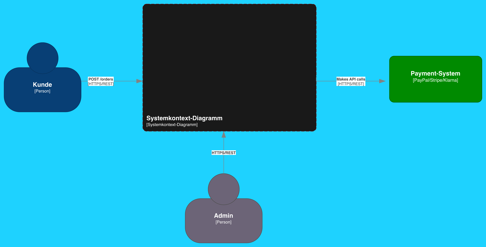
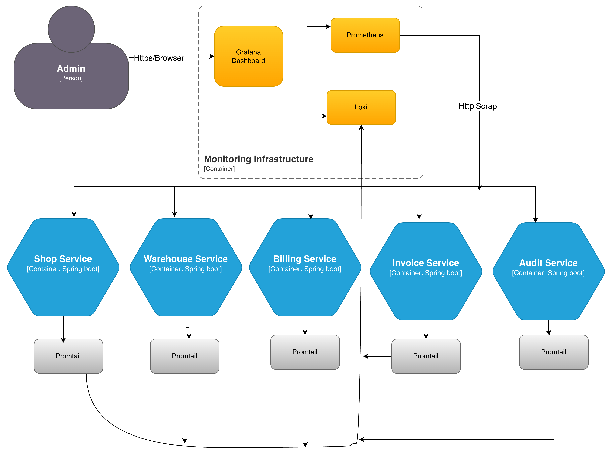

# Architekturdokumentation - Order Processing System

Dieses Dokument beschreibt die Architektur des Microservice-basierten Bestellsystems gemäß den Anforderungen. Das System implementiert einen hybriden Kommunikationsansatz (REST & Kafka) und ein Event-Sourcing-Light System zur Auditierung.

> Die aktuellen Mermaid-Diagramme für die Gesamtarchitektur befinden sich in [system-diagrams.md](./system-diagrams.md).

> Hinweis: Die aktuell implementierten .NET-Services (Warehouse, Invoice, Audit) sind zusätzlich mit Mermaid-Diagrammen in [dotnet-services-diagrams.md](./dotnet-services-diagrams.md) dokumentiert.

---

## 1. Systemkontext-Diagramm

Das Systemkontext-Diagramm beschreibt die Abgrenzung des „Order Processing Systems“ zu externen Akteuren und externen Systemen. Es zeigt, welche Benutzer und Fremdsysteme mit der Microservice-Landschaft interagieren.


[Systemkontext-Diagramm](./images/system-context.png)



*   **Kunde:** Initiiert den Bestellprozess über den Shop-Service.
*   **Payment-Provider-Stubs:** Externe Schnittstellen (Simulatoren) für die Zahlungsabwicklung (z. B. Klarna, PayPal).
*   **System-Grenze:** Das "Order Processing System" kapselt alle internen Validierungs-, Lager- und Abrechnungsprozesse.

---

## 2. Komponentendiagramm
Die Architektur basiert auf einem hybriden Kommunikationsansatz aus synchronen REST-Aufrufen und asynchroner Event-Kommunikation über Kafka.


Das System besteht aus mehreren unabhängigen Microservices:

* Shop-Service
* Warehouse-Service
* Billing-Service
* Payment-Fassade
* Invoice-Service
* Audit-Service

Die Services kommunizieren über einen hybriden Ansatz aus synchroner REST-Kommunikation und asynchroner Event-Kommunikation über Kafka.

* **Synchron:**
    * Shop-Service ↔ Warehouse-Service
    * Shop-Service ↔ Billing-Service

* **Asynchron (Kafka Events):**
    * Billing-Service → Invoice-Service
    * Billing-Service → Warehouse-Service
    * Alle Services → Audit-Service

Jeder Service besitzt eine eigene Datenbank („Database per Service“), um geringe Kopplung, unabhängige Skalierung und klare Verantwortlichkeiten zu gewährleisten.
Übersicht der internen Services, Schnittstellen und Kommunikationswege.

Zusätzlich umfasst das System eine Monitoring- und Logging-Infrastruktur:




* **Prometheus**
    * sammelt Metriken aller Services

* **Loki**
    * zentralisiert Logs aller Services

* **Grafana**
    * visualisiert Metriken und Logs für Monitoring und Fehleranalyse durch Administratoren
---

## 3. Sequenzdiagramm - Happy Path (UML)
Der erfolgreiche Ablauf einer Bestellung ohne Fehlerzustände.


**Kernschritte:**
1. **Order Initiation:** Shop-Service generiert eine `correlationId` und publiziert `ORDER_PLACED`.
2. **Synchronous Reservation:** Warehouse-Service reserviert Artikel via REST.
3. **Synchronous Payment:** Billing-Service delegiert via Payment-Fassade an den Provider.
4. **Asynchronous Processing:** Nach `PAYMENT_SUCCESS` erstellt der Invoice-Service die PDF und das Warehouse bucht den Bestand endgültig aus.
5. **Completion:** Shop-Service setzt den Status auf `COMPLETED`.

---

## 4. Sequenzdiagramm - Fehlerszenario (UML)

[Sequenzdiagramm Fehlerszenario](./images/error-scenario.png)

---

# 5. Event-Konzept

## Architektur-Grundlage

- **Kafka** ist der zentrale Message Bus für alle asynchronen Prozesse
- Zwei Verbindungen bleiben **synchron per REST**, weil der Shop-Service die Antwort abwarten muss, bevor der Bestellstatus gesetzt werden kann

---

## Synchron REST

| Von | Nach | Grund |
|-----|------|-------|
| Shop-Service | Warehouse-Service | Lagerprüfung und Reservierung müssen bestätigt sein |
| Shop-Service | Billing-Service | Zahlungsbestätigung muss vorliegen bevor `COMPLETED` gesetzt wird |

---

## Kafka-Architektur: Event-Fluss & Designentscheidungen

---

###  Topics & Events

# Kafka-Architektur: Event-Fluss & Designentscheidungen

---

### . Topics & Events

#### `orders` – Bestellprozess (Publisher: Shop-Service)

| Event | Consumer | Reaktion |
| :--- | :--- | :--- |
| `ORDER_CREATED` | Audit | Persistiert Start der Bestellung. |
| `ORDER_COMPLETED` | Audit, **Invoice**, Warehouse | **Erstellt PDF-Rechnung.** Warehouse bucht Lager ab (`STOCK_COMMITTED`). |
| `ORDER_CANCELLED` | Audit, Notification | Informiert Kunden über Storno. |
| `RESERVATION_ROLLBACK_REQUESTED` | Audit, **Warehouse** | **Warehouse gibt reservierte Artikel frei** (`STOCK_RELEASED`). |

#### `payments` – Zahlungen (Publisher: Billing-Service)

| Event | Consumer | Reaktion |
| :--- | :--- | :--- |
| `PAYMENT_INITIALIZED` | Audit | Persistiert Start des Bezahlvorgangs. |
| `PAYMENT_SUCCEEDED` | Audit, **Shop** | **Setzt Order auf `COMPLETED`.** |
| `PAYMENT_FAILED` | Audit, **Shop** | **Triggert `ORDER_CANCELLED` + `RESERVATION_ROLLBACK_REQUESTED`.** |

#### `warehouse` – Lager (Publisher: Warehouse-Service)

| Event | Consumer | Reaktion |
| :--- | :--- | :--- |
| `STOCK_RESERVED` | Audit | Protokolliert erfolgreiche Reservierung (nach REST vom Shop). |
| `STOCK_COMMITTED` | Audit | Protokolliert finale Ausbuchung (nach `ORDER_COMPLETED`). |
| `STOCK_RELEASED` | Audit | Protokolliert Freigabe (nach `RESERVATION_ROLLBACK_REQUESTED`). |
| `STOCK_RESERVATION_FAILED` | Audit, **Shop** | **Triggert `ORDER_CANCELLED` + `RESERVATION_ROLLBACK_REQUESTED`.** |

#### `invoices` – Buchhaltung (Publisher: Invoice-Service)

| Event | Consumer | Reaktion |
| :--- | :--- | :--- |
| `INVOICE_REQUESTED` | Audit | Versendet PDF-Rechnung an Kunden. |

---

##  Warum dedizierte Topics?

1. **Fehler-Isolierung:** Eine „Poison Pill" in `payments` blockiert nur die Zahlungsverarbeitung – `orders` und `warehouse` laufen weiter.
2. **Weniger Netzlast:** Services empfangen nur fachlich relevante Events, statt alles zu filtern.
3. **Schema-Evolution:** Jedes Team versioniert seine Events unabhängig.

---

##  Warum konsumiert Invoice `ORDER_COMPLETED` statt `PAYMENT_SUCCEEDED`?

1. **Steuerrecht:** Die Rechnung darf erst bei gesichertem Leistungsaustausch ausgestellt werden. `ORDER_COMPLETED` bestätigt, dass auch das Lager erfolgreich abgebucht hat.
2. **Datenvollständigkeit:** Das `ORDER_COMPLETED`-Event enthält Adresse, Artikelnamen und Steuersätze – der Payment-Service kennt nur Finanzdaten.
3. **Keine Stornorechnung nötig:** Eine zu früh erstellte Rechnung müsste bei späterem Abbruch aufwendig storniert werden.

---

## 4. Audit-Service

Abonniert alle vier Topics simultan. Speichert in **PostgreSQL** nach dem **Append-Only-Prinzip** (nur `INSERT`, kein `UPDATE`/`DELETE`) – für lückenlose Compliance und Support-Nachvollziehbarkeit.

---

## Event-Übersicht

| Event | Topic | Happy Path |
| :--- | :--- | :---: |
| `ORDER_CREATED` | `orders` | ✅ |
| `STOCK_RESERVED` | `warehouse` | ✅ |
| `PAYMENT_INITIALIZED` | `payments` | ✅ |
| `PAYMENT_SUCCEEDED` | `payments` | ✅ |
| `ORDER_COMPLETED` | `orders` | ✅ |
| `STOCK_COMMITTED` | `warehouse` | ✅ |
| `INVOICE_REQUESTED` | `invoices` | ✅ |
| `STOCK_RESERVATION_FAILED` | `warehouse` | ❌ |
| `PAYMENT_FAILED` | `payments` | ❌ |
| `RESERVATION_ROLLBACK_REQUESTED` | `orders` | ❌ |
| `ORDER_CANCELLED` | `orders` | ❌ |
| `STOCK_RELEASED` | `warehouse` | ❌ |

---

## Problem: Redundante Event-DTOs

Ein naiver Ansatz erstellt pro Ereignis eine eigene Klasse (`OrderCreatedEvent`, `PaymentSucceededEvent` …), die jeweils dieselben Metadaten (`eventId`, `source`, `occurredAt`, `correlationId`) wiederholt. Der Audit-Service müsste jeden Typ separat behandeln und bei jedem neuen Event-Typ angepasst werden.
---

## Problem: Redundante Event-DTOs

Ein naiver Ansatz erstellt pro Ereignis eine eigene Klasse (`OrderCreatedEvent`, `PaymentSucceededEvent` …), die jeweils dieselben Metadaten (`eventId`, `source`, `occurredAt`, `correlationId`) wiederholt. Der Audit-Service müsste jeden Typ separat behandeln und bei jedem neuen Event-Typ angepasst werden.

## Problem: spezifische Event-DTOs pro Ereignis

Ein naiver Ansatz würde für jedes Ereignis eine eigene Klasse erstellen:

```
OrderCreatedEvent.java
OrderCompletedEvent.java
OrderCancelledEvent.java
ReservationRollbackEvent.java
PaymentSucceededEvent.java
...
```

Jede Klasse trägt dabei dieselben Metadaten – `eventId`, `source`, `occurredAt`,
`correlationId` – redundant wiederholt. Der AuditService müsste jeden dieser Typen
kennen und separat behandeln. Kommt ein neuer Event-Typ hinzu, muss der AuditService
angepasst werden, obwohl er inhaltlich nichts Neues tut.

---

## Lösung: Envelope Pattern mit `DomainEvent<T>`

```
┌────────────────────────────────────────────┐
│              DomainEvent<T>                │  ← einheitlicher Wrapper (Envelope)
│                                            │
│  eventId        UUID       (Deduplizierung)│
│  eventType      String     ("ORDER_CREATED")│
│  source         String     ("shop-service") │
│  correlationId  UUID       (Flow-Tracking)  │
│  occurredAt     LocalDateTime               │
│  payload        T          ← fachlicher    │
│                               Inhalt        │
└────────────────────────────────────────────┘
```

Der Envelope trennt zwei Verantwortlichkeiten sauber:

| Teil | Inhalt | Ändert sich |
|---|---|---|
| Envelope | technische Metadaten | selten |
| Payload `T` | fachlicher Inhalt pro Event | häufig, pro Service |

### Vorteile

**1 – AuditService ist vollständig entkoppelt**

Der AuditService konsumiert Events aus allen Topics (`orders`, `warehouse`,
`payments`, `invoices`) und persistiert alles. Er muss `payload` nie
deserialisieren – er speichert es als rohen JSON-String (JSONB):

```java
DomainEvent<JsonNode> envelope = objectMapper.readValue(raw, new TypeReference<>(){});

AuditEvent.builder()
    .eventId(envelope.eventId())
    .eventType(envelope.eventType())     // "ORDER_CANCELLED"
    .source(envelope.source())           // "shop-service"
    .correlationId(envelope.correlationId())
    .payload(envelope.payload().toString()) // roher JSON-Blob → JSONB
    .build();
```

Ein neuer Event-Typ aus einem neuen Service wird **automatisch gespeichert**,
ohne eine einzige Code-Änderung im AuditService.

**2 – Idempotenz über `eventId`**

Kafka garantiert *at-least-once*. Dasselbe Event kann doppelt ankommen.
Jeder Consumer kann Duplikate anhand der `eventId` erkennen und überspringen:

```java
if (processedEventRepository.existsByEventId(envelope.eventId())) {
    return; // Duplikat – bereits verarbeitet
}
```

**3 – Korrelation über den gesamten Flow**

Alle Events einer einzigen Order tragen dieselbe `correlationId`.
Im AuditService lässt sich damit der komplette Lebenszyklus einer Order
in chronologischer Reihenfolge rekonstruieren:

```
correlationId: abc-123
├── ORDER_CREATED             (shop-service)
├── STOCK_RESERVED            (warehouse-service)
├── PAYMENT_INITIATED         (shop-service)
├── PAYMENT_SUCCEEDED         (payment-service)
└── ORDER_COMPLETED           (shop-service)
```

**4 – Andere Services deserialisieren nur was sie brauchen**

WarehouseService und InvoiceService empfangen ebenfalls `DomainEvent<JsonNode>`,
prüfen `eventType` und deserialisieren `payload` nur bei relevanten Events
in ihre eigene lokale Payload-Klasse:

```java
switch (envelope.eventType()) {
    case "RESERVATION_ROLLBACK_REQUESTED" -> {
        ReservationRollbackPayload p =
            objectMapper.treeToValue(envelope.payload(), ReservationRollbackPayload.class);
        reservationService.rollback(p.reservationId());
    }
    default -> { /* ignorieren */ }
}
```

---

## Shared-Kernel Modul

`DomainEvent<T>` ist ein **technischer Vertrag**, der von allen Services
gleich interpretiert werden muss. Deswegen liegt er in einem minimalen
`shared-kernel`-Modul.

```
vseonlineshop/
├── shared-kernel/                ← nur DomainEvent<T>, keine fachlichen Klassen
│   └── DomainEvent.java
│
├── shop-service/                 ← dependency: shared-kernel
│   └── event/
│       ├── OrderCreatedPayload.java     ← fachlich, bleibt lokal
│       └── OrderCompletedPayload.java
│
├── warehouse-service/            ← dependency: shared-kernel
│   └── event/
│       └── ReservationRollbackPayload.java  ← eigene lokale Kopie
│
└── audit-service/                ← dependency: shared-kernel
    └── (keine Payload-Klassen)   ← JsonNode reicht
```

### Warum Payload-DTOs NICHT im shared-kernel?

Payload-DTOs sind **fachliche Verträge** die sich häufig ändern. Würden sie
geteilt, entsteht versteckte Kopplung: eine Änderung in `OrderCreatedPayload`
im Shop zwingt alle Services zum gleichzeitigen Update – der Kernvorteil
von Microservices (unabhängige Deployments) geht verloren.

Jeder Consumer definiert seine eigene lokale Payload-Klasse mit genau den
Feldern, die er braucht. Felder die er nicht kennt, ignoriert Jackson
automatisch (`FAIL_ON_UNKNOWN_PROPERTIES = false`).

| | `DomainEvent<T>` | Payload DTOs |
|---|---|---|
| Charakter | technisch | fachlich |
| Ändert sich | selten | häufig |
| Wo | `shared-kernel` | lokal pro Service |
| Wer braucht es | alle Services | nur der jeweilige Consumer |
---

## 6. Service Design

### 6.1 Shop-Service Design

### ER-Diagramm


### Entscheidung: Verwendung von UUIDs als Primärschlüssel

**Begründung:**

* **Schutz vor ID Enumeration Attacks**
    * Fortlaufende IDs (`/orders/1001`) sind leicht erratbar.
    * UUIDs sind zufällig und nicht vorhersagbar.
    * Erhöht die Sicherheit gegen unbefugten Zugriff auf fremde Ressourcen.

* **Dezentrale ID-Generierung**
    * IDs können direkt im Service generiert werden (`UUID.randomUUID()`).
    * Keine Abhängigkeit von der Datenbank zur ID-Erzeugung.

* **Asynchrone Entkopplung**
    * Die ID steht bereits vor der Persistierung für Kafka-Events und REST-Aufrufe bereit.
    * Unterstützt event-getriebene Microservice-Kommunikation ohne blockierende Datenbankoperationen.

* **Schutz von Geschäftsgeheimnissen**
    * UUIDs verhindern Rückschlüsse auf Bestellvolumen oder Unternehmenswachstum durch fortlaufende IDs.

* **Globale Eindeutigkeit**
    * UUIDs sind weltweit eindeutig.
    * Mehrere Services können unabhängig Entitäten erzeugen, ohne ID-Konflikte zu riskieren.

### API-Design

### Synchroner Flow mit parallelem Kafka

```
Client ──POST /orders──► Shop-Service
   { productId, quantity }     │
                               │──── Kafka: OrderCreated ──► AuditService
                               │                             (fire & forget)
                    ┌──────────▼──────────┐
                    │ 1. Warehouse-Service │ (REST sync)
                    │  POST /reservations  │
                    │  ← reservationId     │
                    │  ← productName       │──── Kafka: StockReserved ──► AuditService
                    │  ← unitPrice         │                              (fire & forget)
                    └──────────┬───────────┘
                               │ Shop berechnet totalAmount
                    ┌──────────▼──────────┐
                    │ 2. Billing-Service   │ (REST sync)
                    │  POST /payments      │──── Kafka: PaymentInitiated ──► AuditService
                    │  { totalAmount }     │                                 (fire & forget)
                    │                      │
                    │  Payment Provider    │
                    │  returns SUCCESS     │
                    │  ← 200 CONFIRMED     │──── Kafka: PaymentSucceeded ──► InvoiceService
                    └──────────┬───────────┘                             ──► AuditService
                               │                                         ──► Warehouse
                    ┌──────────▼──────────┐                                  (alle async)
                    │ 3. DB Update         │
                    │  status = COMPLETED  │──── Kafka: OrderCompleted ──► AuditService
                    └──────────┬───────────┘                               (fire & forget)
                               │
Client ◄── 201 COMPLETED ──────┘
```

> **Kafka = fire-and-forget:** Jeder Service publiziert seinen Event
> sofort und wartet nicht auf Consumer. Der Client wartet
> ausschliesslich auf die synchrone REST-Kette.

---

### POST /orders

### Request vom Client

> Client schickt **keine Preise** — Preise kommen von Warehouse.
> Verhindert Preismanipulation durch den Client.

```http
POST /orders
Content-Type: application/json
```

```json
{
  "userId": "uuid-optional",
  "items": [
    { "productId": "A1", "quantity": 2 },
    { "productId": "B3", "quantity": 1 }
  ],
  "currency": "EUR"
}
```

**Intern generiert (nicht vom Client):**
- `id` / `correlationId` → eine UUID, vor DB-Insert generiert
- `totalAmount` → berechnet aus Warehouse-Antwort: `sum(quantity × unitPrice)`
- `status` → startet intern als `PENDING`
- `createdAt`, `updatedAt` → Timestamps

---

### Schritt 1 — Shop → Warehouse (intern)

**Shop schickt an Warehouse:**
```json
POST /reservations

{
  "correlationId": "550e8400-e29b-41d4-a716-446655440000",
  "order_id": "550e8400-e29b-41d4-a716-446655440001",
  "items": [
    { "productId": "A1", "quantity": 2 },
    { "productId": "B3", "quantity": 1 }
  ]
}
```

**Warehouse antwortet Shop mit `201`:**
```json
{
  "reservationId": "550e8400-e29b-41d4-a716-446655440000",
  "order_id": "550e8400-e29b-41d4-a716-446655440001",
  "items": [
    {
      "productId": "A1",
      "productName": "Nike Air Max",
      "quantity": 2,
      "unitPrice": 89.99
    },
    {
      "productId": "B3",
      "productName": "Adidas Hose",
      "quantity": 1,
      "unitPrice": 49.99
    }
  ]
}
```

**Was Shop aus dieser Antwort macht:**

| Feld | Verwendung |
|------|------------|
| `reservationId` | Gespeichert in ORDER — nötig um Reservierung bei `PaymentFailed` freizugeben |
| `productName` | Snapshot → gespeichert in ORDER_ITEM |
| `unitPrice` | Snapshot → gespeichert in ORDER_ITEM + Berechnung totalAmount |
| `totalAmount` | `(2 × 89.99) + (1 × 49.99) = 229.97` → weiter an Billing |

---

### Schritt 2 — Shop → Billing (intern)

```json
POST /payments

{
  "correlationId": "550e8400-e29b-41d4-a716-446655440000",
  "orderId": "order-uuid",
  "totalAmount": 229.97,
  "currency": "EUR"
}
```
**Billing antwortet Shop — Erfolg `200 OK`:**
```json
{
  "correlationId": "550e8400-e29b-41d4-a716-446655440000",
  "orderId": "550e8400-e29b-41d4-a716-446655440000",
  "paymentId": "pay-uuid-9c1f",
  "status": "CONFIRMED",
  "paidAt": "2024-01-15T10:00:02Z"
}
```

**Billing antwortet Shop — Fehler `402`:**
```json
{
  "correlationId": "550e8400-e29b-41d4-a716-446655440000",
  "orderId": "550e8400-e29b-41d4-a716-446655440000",
  "status": "FAILED",
  "reason": "INSUFFICIENT_FUNDS"
}
```
---

### Response — Erfolg `201 Created`

```json
{
  "orderId": "550e8400-e29b-41d4-a716-446655440000",
  "status": "COMPLETED",
  "totalAmount": 229.97,
  "currency": "EUR",
  "createdAt": "2024-01-15T10:00:00Z",
  "items": [
    {
      "productId": "A1",
      "productName": "Nike Air Max",
      "quantity": 2,
      "unitPrice": 89.99
    },
    {
      "productId": "B3",
      "productName": "Adidas Hose",
      "quantity": 1,
      "unitPrice": 49.99
    }
  ]
}
```

### Response — Fehler

#### `400 Bad Request`
```json
{ "status": 400, "error": "BAD_REQUEST", "message": "items must not be empty" }
```

#### `409 Conflict` — Lager nicht verfügbar
```json
{ "status": 409, "error": "STOCK_UNAVAILABLE", "message": "Product A1 is out of stock" }
```

#### `402 Payment Required` — Zahlung fehlgeschlagen
```json
{ "status": 402, "error": "PAYMENT_FAILED", "message": "Payment declined by provider" }
```

#### `503 Service Unavailable`
```json
{ "status": 503, "error": "SERVICE_UNAVAILABLE", "message": "Downstream service temporarily unavailable." }
```

---

## GET /orders/{orderId}

```http
GET /orders/550e8400-e29b-41d4-a716-446655440000
```

### Response `200 OK`
```json
{
  "orderId": "550e8400-e29b-41d4-a716-446655440000",
  "status": "COMPLETED",
  "totalAmount": 229.97,
  "currency": "EUR",
  "createdAt": "2024-01-15T10:00:00Z",
  "items": [
    { "productId": "A1", "productName": "Nike Air Max", "quantity": 2, "unitPrice": 89.99 },
    { "productId": "B3", "productName": "Adidas Hose",  "quantity": 1, "unitPrice": 49.99 }
  ]
}
```

### Response `404 Not Found`
```json
{ "status": 404, "error": "ORDER_NOT_FOUND", "message": "Order 550e8400 not found" }
```

---

## GET /actuator/health
```json
{ "status": "UP" }
```

---

## Status-Übergänge

```
PENDING ──► PROCESSING ──► COMPLETED
                │
                └──► CANCELLED  (Stock nicht verfügbar / Payment fehlgeschlagen)
```

| Status | Wann | Sichtbar für Client? |
|--------|------|-------------------|
| `PENDING` | Order angelegt | intern            |
| `PROCESSING` | Warehouse OK, Payment läuft |  intern           |
| `COMPLETED` | Alles erfolgreich | in Response       |
| `CANCELLED` | Fehler bei Warehouse oder Payment |  als Error-Response |

### 6.2 Billing-Service Design
- Payment
- Transaction

---

## 7. Architectural Decision Records (ADRs)

### ADR 1: Wahl des Message Brokers (Kafka)
*   **Entscheidung:** Nutzung von Apache Kafka für die inter-Service Kommunikation.
*   **Begründung:** Kafka bietet hohe Persistenz und Skalierbarkeit. Es ermöglicht dem Invoice-Service und Warehouse-Service, Events unabhängig voneinander zu konsumieren, auch wenn ein Service kurzzeitig offline ist (Resilienz).

### ADR 2: Persistenzstrategie für Audit-Snapshots
*   **Entscheidung:** Relationale Datenbank mit Append-Only Strategie im Audit-Service.
*   **Begründung:** Um Unveränderlichkeit zu garantieren, werden Snapshots nur per `INSERT` gespeichert. Die relationale Struktur erlaubt eine effiziente Abfrage über `GET /audit/orders/{correlationId}` sortiert nach Zeitstempeln.

### ADR 3: Kommunikationsmuster (Hybrider Ansatz)
*   **Entscheidung:** Synchrones REST für User-Interaktionen, asynchrones Kafka für Hintergrundprozesse.
*   **Begründung:** Bestandsprüfung und Zahlung erfordern sofortiges Feedback für den Kunden. Rechnungsdruck und Archivierung sind zeitunkritisch und werden zur Lastverteilung asynchron entkoppelt.

---

## 8. Erweiterbarkeitsanalyse

Um einen vierten Zahlungsanbieter (z. B. "CryptoPay") zu integrieren, sind folgende Schritte nötig:

### Geänderte Dateien/Komponenten:
*   **Billing-Service (Payment-Fassade):** Implementierung einer neuen Klasse `CryptoPayAdapter`, die das interne `PaymentProvider`-Interface bedient.
*   **Configuration:** Hinzufügen der neuen Provider-Credentials (API-Key, Endpoint) in der `application.properties` oder `config.json`.
*   **Factory/Registry:** Registrierung des neuen Providers in der Fassaden-Logik, damit dieser über das `method`-Feld im Request angesteuert werden kann.

### Unveränderte Dateien/Komponenten:
*   **Shop-Service:** Die Schnittstelle zum Billing-Service bleibt identisch (`POST /payments`).
*   **Invoice- & Warehouse-Service:** Diese erhalten weiterhin nur das standardisierte `PAYMENT_SUCCESS`-Event von Kafka, unabhängig vom gewählten Anbieter.
*   **Audit-Service:** Das Event-Format für Snapshots bleibt konsistent.
