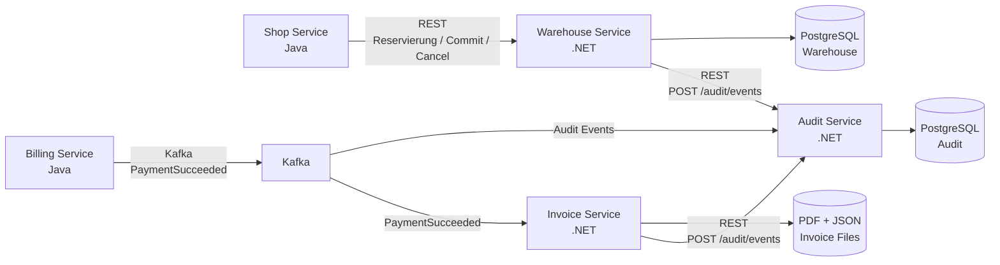
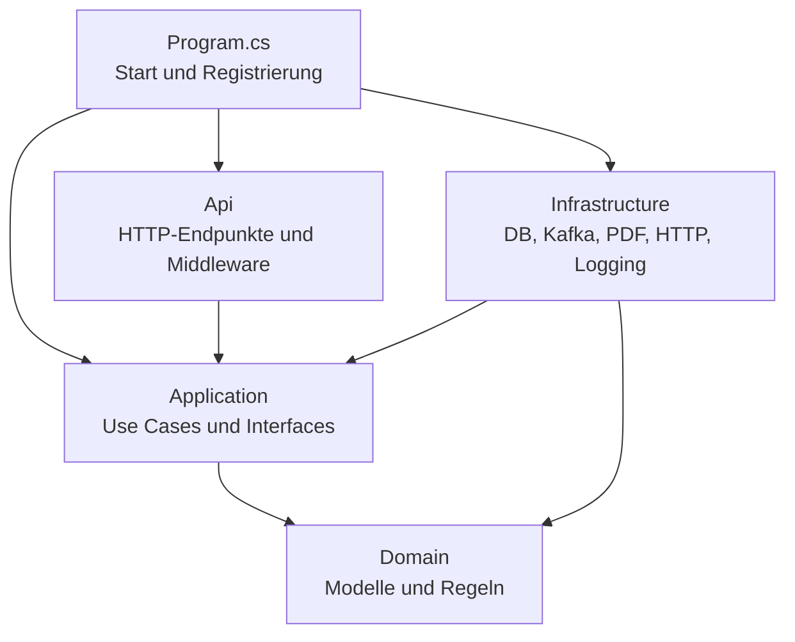
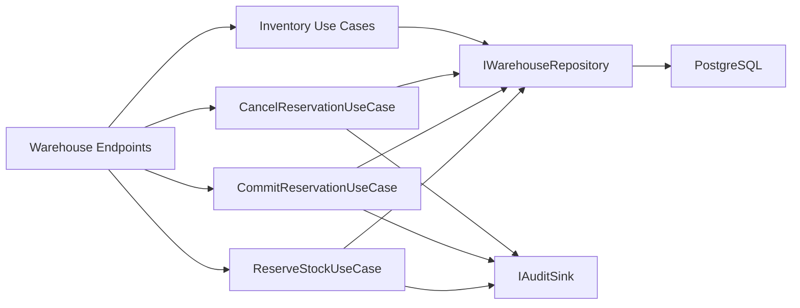
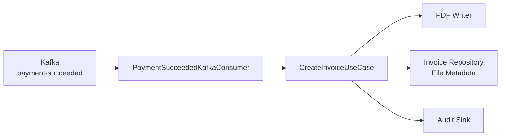
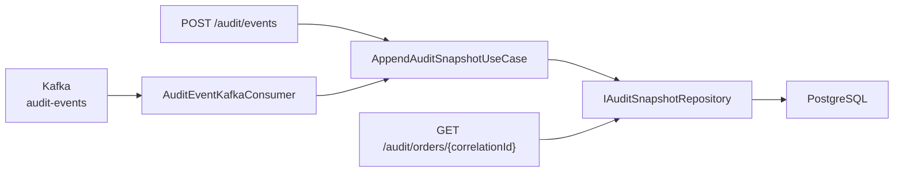
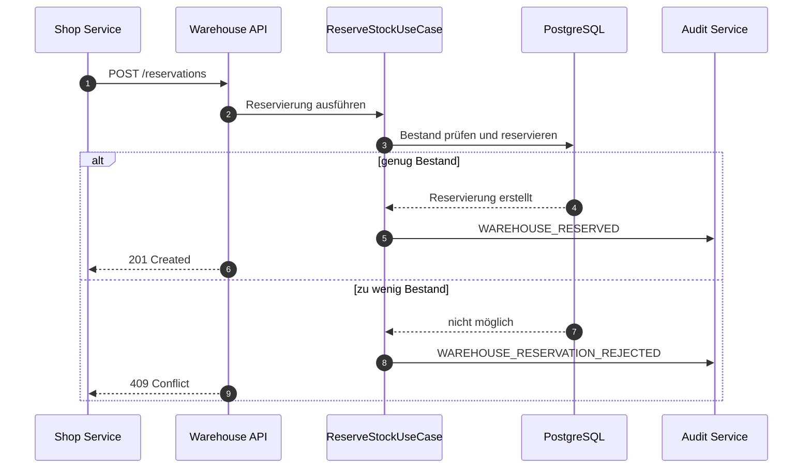
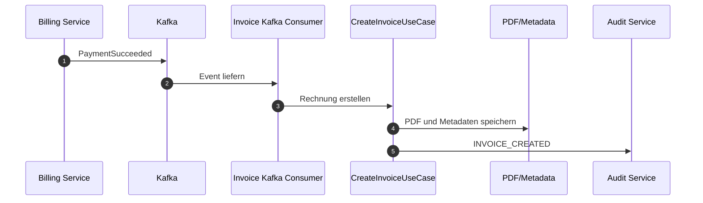
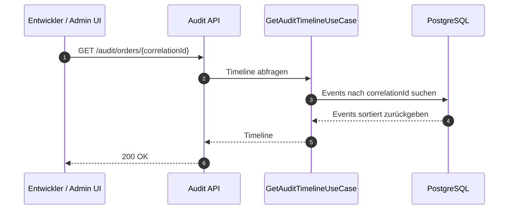

# Diagramme für die .NET-Services

Dieses Dokument zeigt den .NET-Teil des Projekts mit einfachen Mermaid-Diagrammen.

Die Diagramme sollen helfen, den Code schneller zu verstehen.

## 1. Überblick



Wichtig:

- Warehouse ist synchron über REST.
- Invoice ist asynchron über Kafka.
- Audit kann REST und Kafka.

## 2. Clean Architecture



Die wichtigste Regel:

```text
Domain kennt keine Datenbank, kein Kafka und kein ASP.NET Core.
```

## 3. Warehouse Service



Der Service verwaltet Bestand und Reservierungen.

## 4. Invoice Service



Der Consumer enthält nicht die Business-Logik. Er ruft den Use Case auf.

## 5. Audit Service



REST und Kafka nutzen am Ende denselben Use Case.

## 6. Reservierung im Warehouse



## 7. Rechnung über Kafka



## 8. Audit Timeline



## Was man aus den Diagrammen mitnehmen soll

- Warehouse bleibt REST, weil der Shop sofort eine Antwort braucht.
- Invoice nutzt Kafka, weil Rechnungserstellung im Hintergrund passieren kann.
- Audit sammelt Events zentral.
- Die `correlationId` verbindet den ganzen Ablauf.
- Business-Logik liegt in Use Cases, nicht in Endpoints oder Kafka-Consumern.
