# .NET Services - Diagrams

This document explains the .NET part of the online shop system:

- `warehouse-service-dotnet`
- `invoice-service-dotnet`
- `audit-service-dotnet`

The diagrams use Mermaid so they can be rendered directly in GitHub and most Markdown editors.

## 1. Service Context

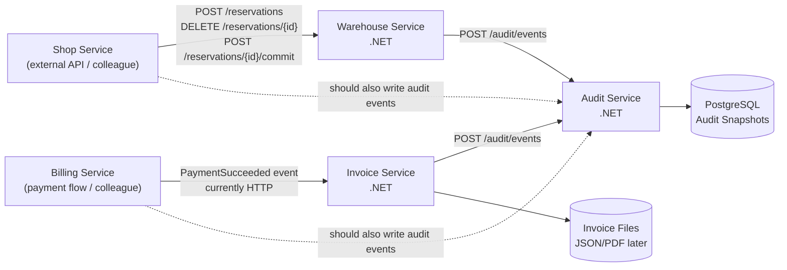

## 2. Clean Architecture Shape

Each .NET service follows the same pragmatic structure.

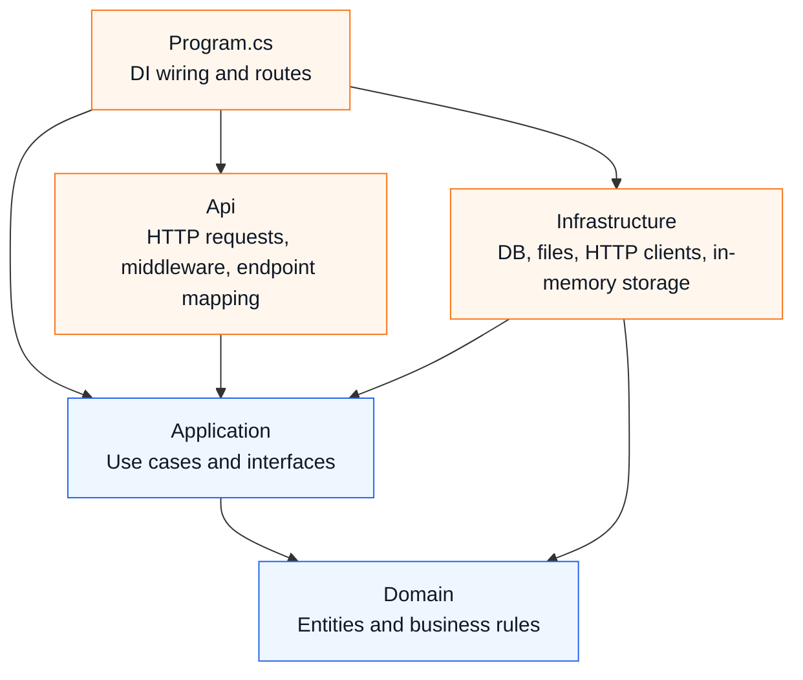

Important rule: `Domain` and `Application` do not depend on ASP.NET Core, PostgreSQL, Docker, Swagger, HTTP, or file storage.

## 3. Warehouse Components

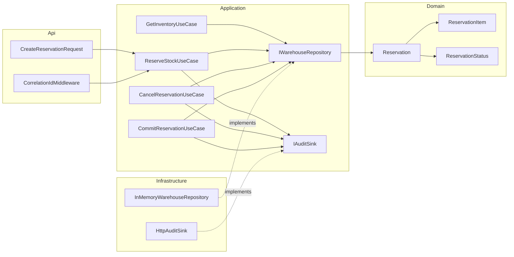

## 4. Invoice Components

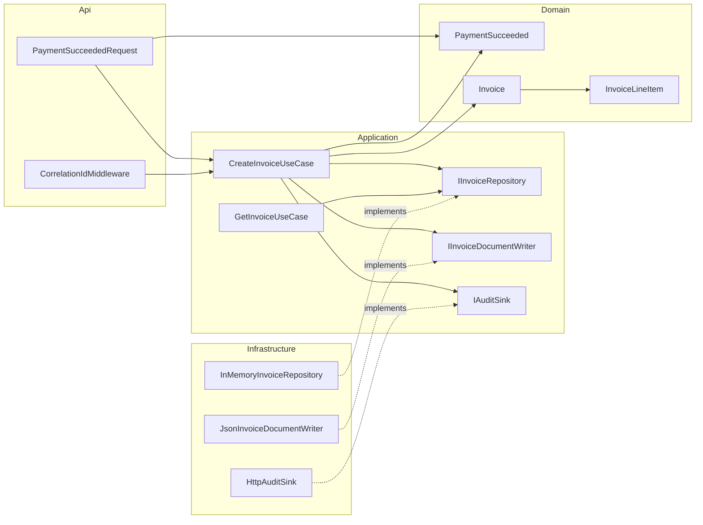

## 5. Audit Components

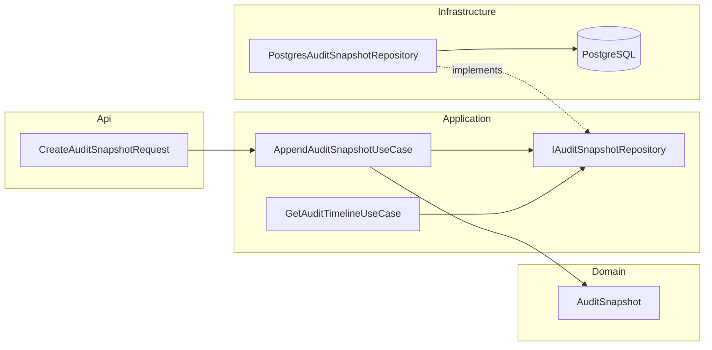

## 6. Warehouse Reservation Flow

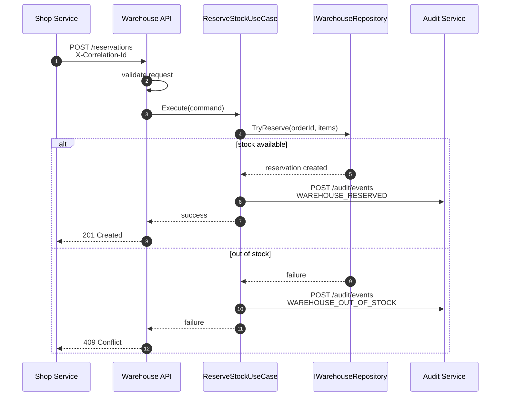

## 7. Warehouse Compensation Flow

This is used when payment fails and the already reserved stock must be released.

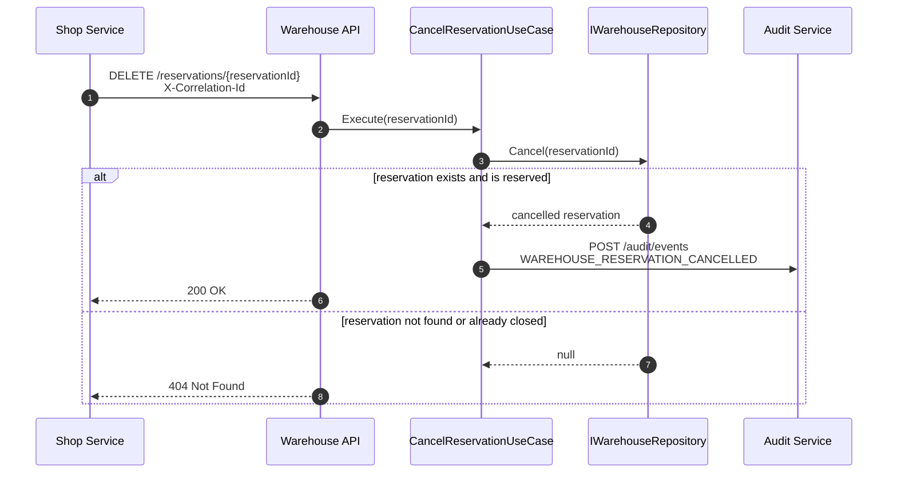

## 8. Invoice Creation With Retry

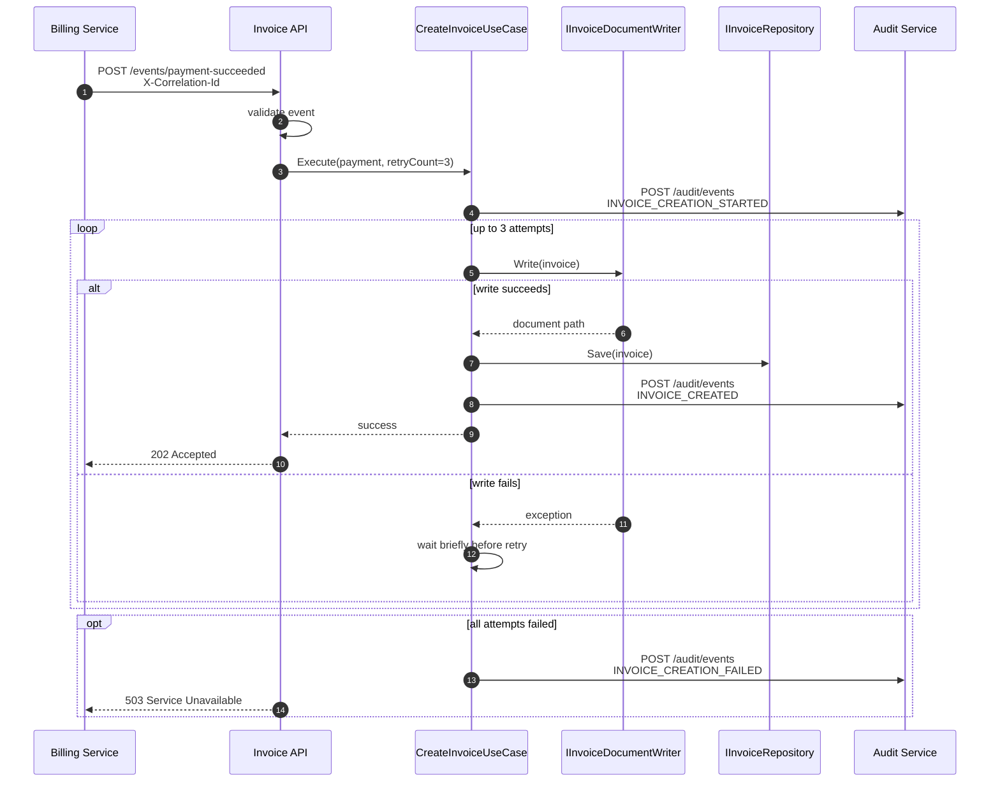

## 9. Audit Timeline Query

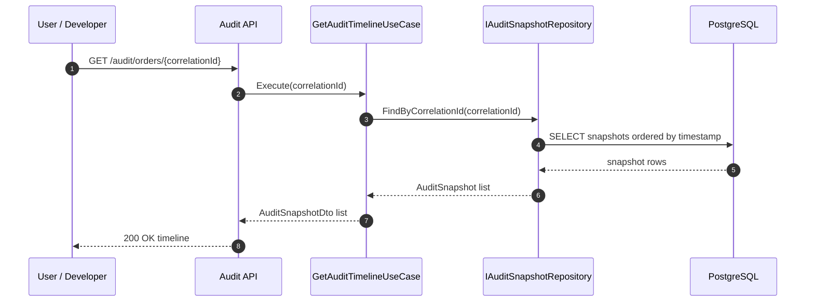

## 10. Audit Snapshot Data Model

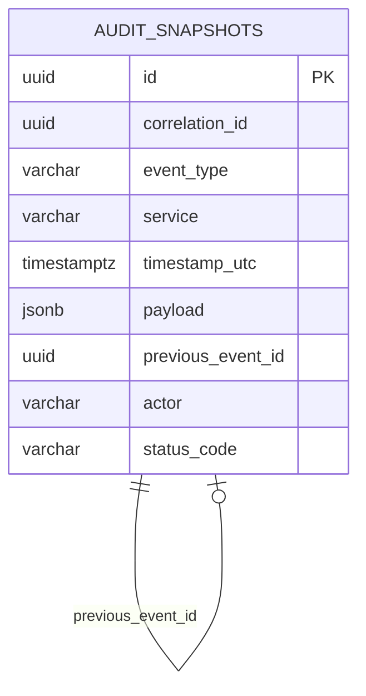

The table is append-only from the application perspective. Every state change is represented by a new row.

## 11. Current Integration Status

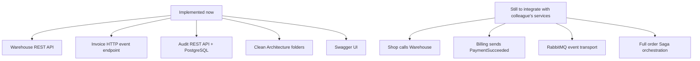
