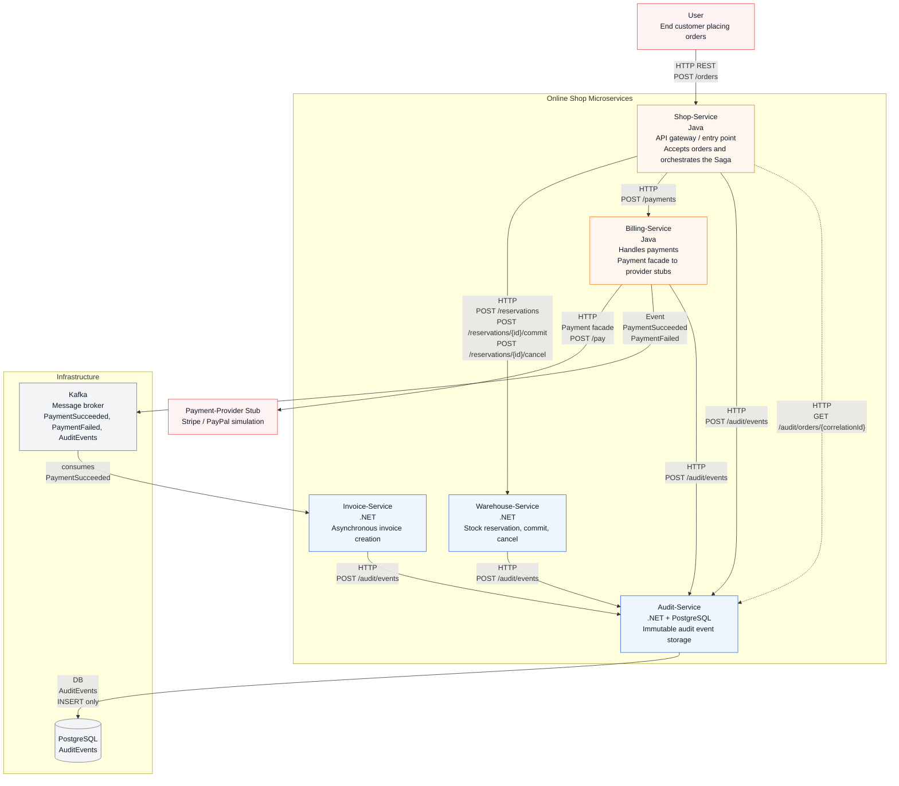
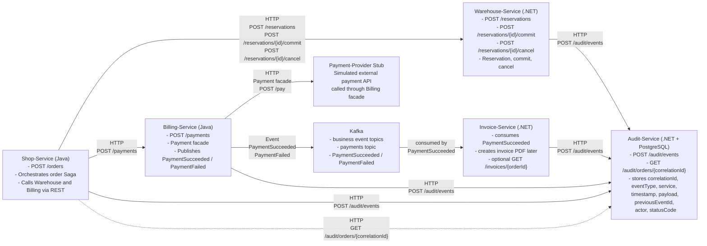
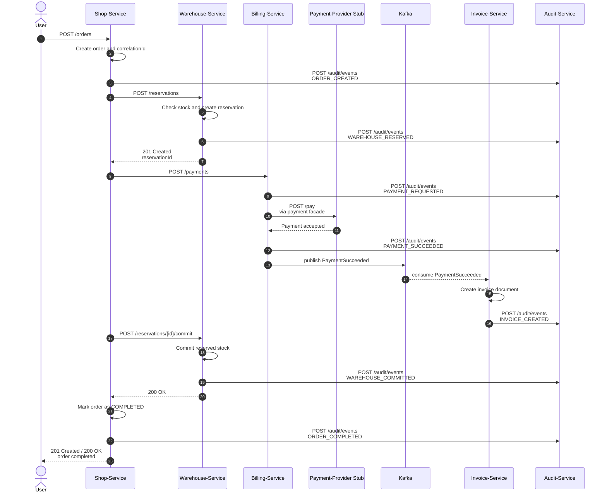
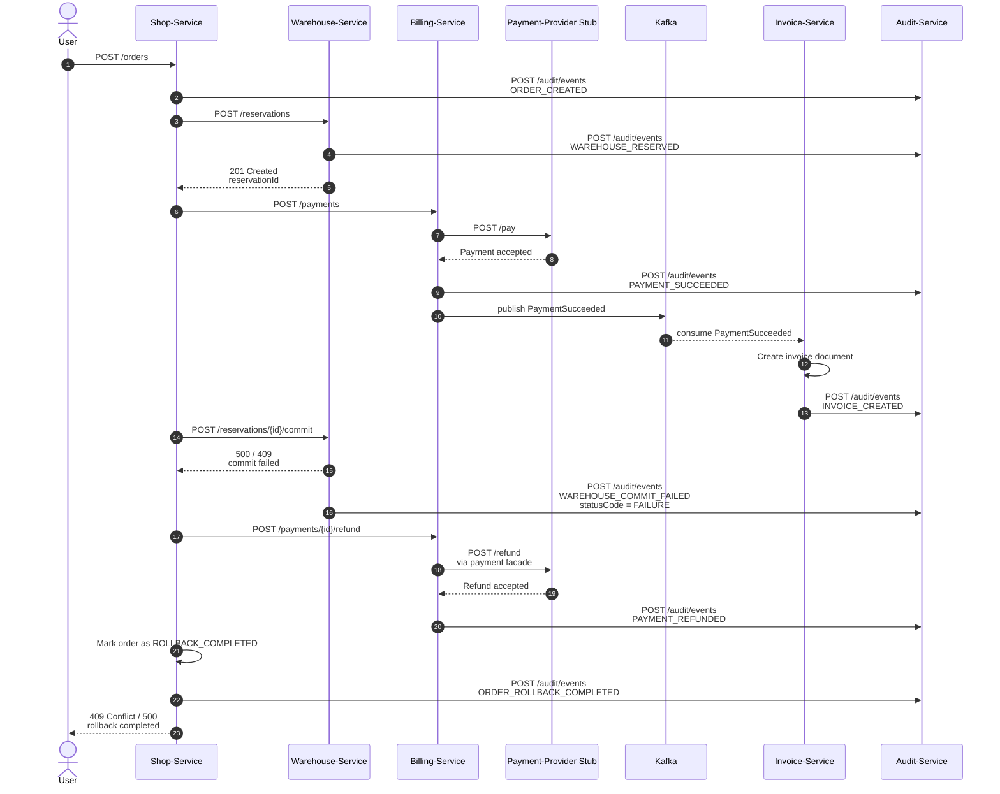
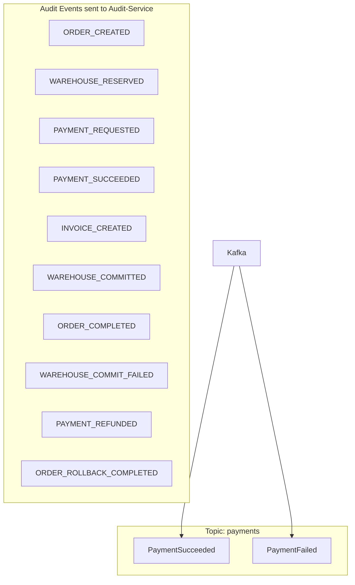

# System Diagrams

This document describes the overall online shop architecture with Java and .NET services.

The diagrams use Mermaid and keep Kafka as the message broker.

## 1. System Context Diagram

## 2. Service / Component Diagram

## 3. Sequence Diagram - Happy Path

## 4. Sequence Diagram - Warehouse Commit Failure

## 5. Event Overview

